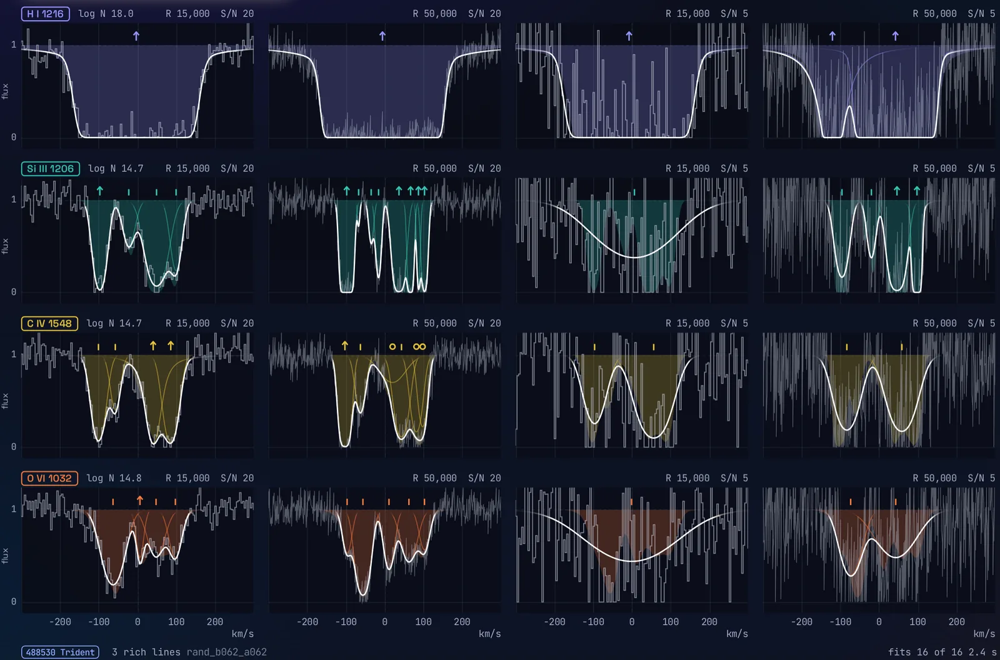
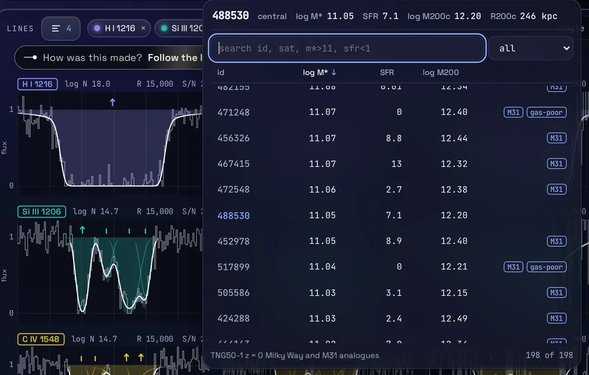
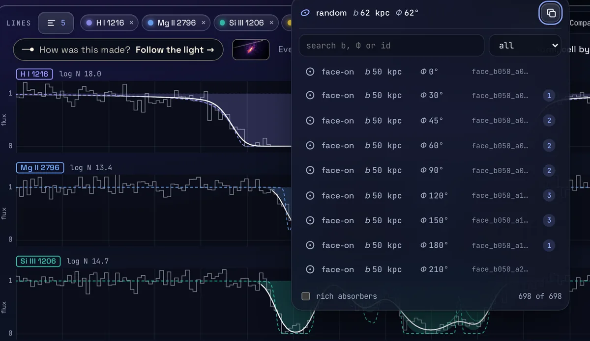
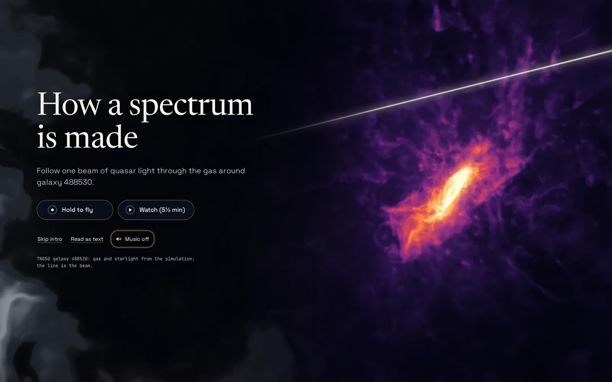
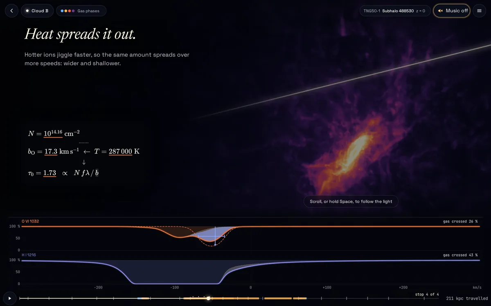
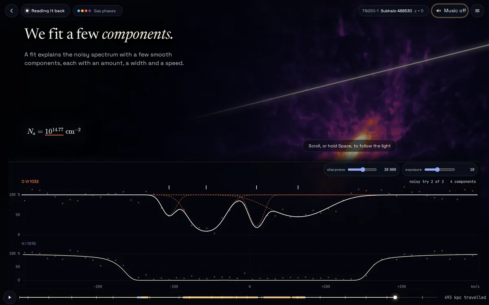
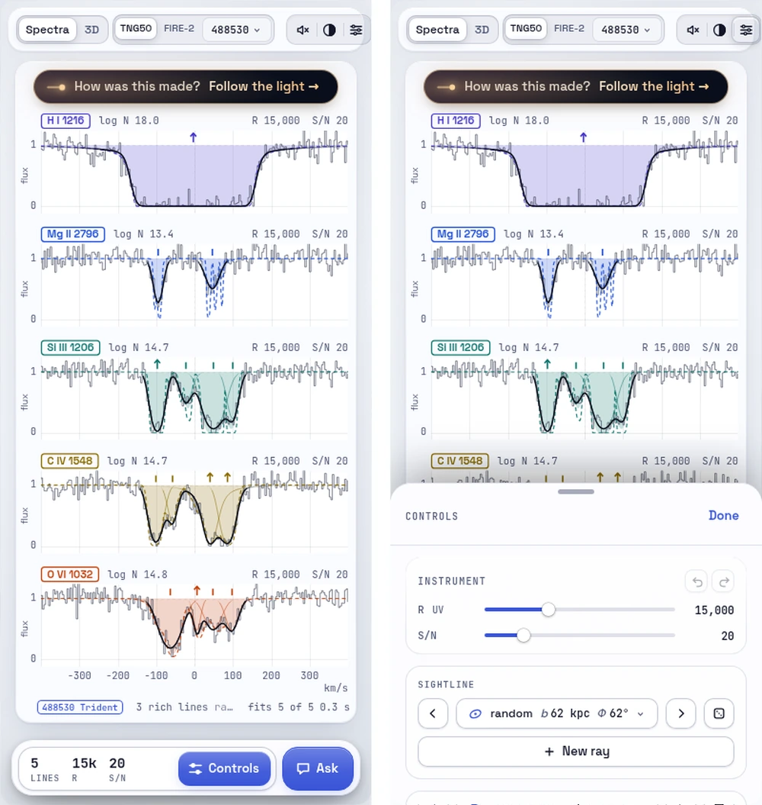

<p align="center">
  <a href="https://galaxies.tanmaysingh.uk"></a>
</p>

<h1 align="center">Seeing the Circumgalactic Medium</h1>

<p align="center"><b>The vast halo of gas around galaxies, revealed by the light it absorbs: in simulations, and for the telescopes that will observe it.</b></p>

<p align="center">
  <a href="https://galaxies.tanmaysingh.uk"></a>
  <a href="https://github.com/tanmay-starslab/cgm-absorber-requirements/actions/workflows/ci.yml"></a>
  <a href="https://github.com/tanmay-starslab/cgm-absorber-requirements/releases"></a>
  <a href="LICENSE"></a>
  <a href="https://www.tng-project.org/data/"></a>
</p>

<p align="center">
  <a href="https://galaxies.tanmaysingh.uk/"><b>Explorer</b></a> &nbsp;|&nbsp;
  <a href="https://galaxies.tanmaysingh.uk/learn/how-a-spectrum-is-made/"><b>How an absorption spectrum is made</b></a> &nbsp;|&nbsp;
  <a href="https://galaxies.tanmaysingh.uk/requirements/"><b>Detect & Resolve</b></a> &nbsp;|&nbsp;
  <a href="#technical-details"><b>Technical details</b></a>
</p>

Every galaxy sits inside a vast halo of thin gas, the circumgalactic medium (CGM). It holds much of a galaxy's raw
material, yet it is far too faint to photograph. We see it only when a distant quasar shines through it: each kind of
atom takes its own small bite out of the light, and those dips, the absorption spectrum, tell us how much gas there
is, how hot it is and how it moves.

This project lets you explore the CGM of simulated galaxies from TNG50. Point a beam through any of 198 Milky Way and Andromeda
look-alikes, read the spectrum it makes, change the telescope, and see what a real instrument would be able to tell.

## What you can do

### Read the light from 198 simulated galaxies

<p align="center"><a href="https://galaxies.tanmaysingh.uk/"></a></p>
<p align="center"><sub>Twelve ions, from cool hydrogen to million-degree oxygen, along one sightline. Fits run in your browser.</sub></p>

### Change the telescope

<p align="center"></p>
<p align="center"><sub>Set the resolving power and the signal-to-noise, side by side, and watch the detail survive or vanish.</sub></p>

### Fly through the gas in 3D

<table>
  <tr>
    <td width="45%"></td>
    <td>Turn the galaxy around and see the gas your beam passes through: density, temperature, metals, each of the
    twelve ions, the gas velocities and the starlight, with the sightline drawn in place. Pick a point to cast a new
    beam.</td>
  </tr>
</table>

### Pick any galaxy, any sightline

<table>
  <tr>
    <td width="50%"></td>
    <td width="50%"></td>
  </tr>
  <tr>
    <td align="center"><sub>Filter 198 galaxies by mass, star formation or type.</sub></td>
    <td align="center"><sub>Choose a beam by orientation, distance and angle, or cast a new one.</sub></td>
  </tr>
</table>

### Watch a spectrum being made

<p align="center"><a href="https://galaxies.tanmaysingh.uk/learn/how-a-spectrum-is-made/"></a></p>

<table>
  <tr>
    <td width="50%"></td>
    <td width="50%"></td>
  </tr>
</table>
<p align="center"><sub>Follow one sightline cell by cell, from the gas to a fitted spectrum. Scroll at your own pace or watch the film. Five shorter stories start from the same welcome screen.</sub></p>

### Ask in plain language

A chat panel answers questions about what is on screen and drives the page for you. It can only act through the
page's own tools, and any number it did not get from a tool is marked as unverified.

### Design an instrument

<p align="center"><a href="https://galaxies.tanmaysingh.uk/requirements/"></a></p>
<p align="center"><sub>Detect & Resolve, where the project began: the signal-to-noise and resolving power needed to detect an absorber and split it into components.</sub></p>

### Take it with you

<table>
  <tr>
    <td width="34%" align="center"></td>
    <td>The explorer and the story work on a phone, with the same spectra and fits. Nothing to install: it all runs in the browser.</td>
  </tr>
</table>

## The three pages

| Page | Link | What it is |
|---|---|---|
| **Explorer** | [galaxies.tanmaysingh.uk](https://galaxies.tanmaysingh.uk/) | Sightlines, spectra, fits, 3D gas and chat for 198 TNG50 galaxies |
| **How an absorption spectrum is made** | [/learn/how-a-spectrum-is-made/](https://galaxies.tanmaysingh.uk/learn/how-a-spectrum-is-made/) | A cinematic story from gas cells to a fitted spectrum |
| **Detect & Resolve** | [/requirements/](https://galaxies.tanmaysingh.uk/requirements/) | The instrument study: what S/N and resolution it takes to detect and resolve an absorber |

## Credit

This is not a published work, so there is nothing formal to cite. If the site or the code helps you, a short
acknowledgement with a link to https://galaxies.tanmaysingh.uk is kindly appreciated. The simulation and the tools it
builds on have their own citation requests, listed under [Credits](#credits).

## Feedback and contributing

Found a bug, spotted a number that looks wrong, or have an idea? We would love to hear it. Open an
[issue](https://github.com/tanmay-starslab/cgm-absorber-requirements/issues), or read
[CONTRIBUTING.md](CONTRIBUTING.md) to send a pull request.

---

## Technical details

What began as a requirements study for a NASA proposal (what S/N and resolving power it takes to **detect** a
circumgalactic absorber and to **resolve** it into velocity components) has grown into a public website for exploring
the circumgalactic medium (CGM) of simulated galaxies. The three pages map to these sources:

| Page | Source |
|---|---|
| Explorer | `docs/tng50/` ([below](#tng50-sightline-explorer)) |
| How an absorption spectrum is made | `docs/tng50/learn/` ([below](#learn-page-how-an-absorption-spectrum-is-made)) |
| Detect & Resolve | `docs/index.html`, `absreq/`, `paper/` |

Old `tanmay-starslab.github.io/cgm-absorber-requirements/...` links redirect to the new site.

<details>
<summary><b>Detect &amp; Resolve: method, transitions and figures</b></summary>

### Detect & Resolve


### Transitions

| Ion | λ [Å] | f | b_fid [km/s] | log N(τ₀=1) | Source |
|---|---|---|---|---|---|
| H I | 1215.67 | 0.416 | 13.8 | 13.26 | Trident |
| Mg II | 2796.35 | 0.6155 | 5.6 | 12.34 | Morton (2003) |
| Si II | 1260.42 | 1.18 | 5.6 | 12.40 | Trident |
| S II | 1259.52 | 0.0182 | 5.5 | 14.20 | Trident |
| C II | 1334.53 | 0.129 | 6.2 | 13.38 | Trident |
| Si III | 1206.50 | 1.63 | 6.5 | 12.35 | Trident |
| Si IV | 1402.77 | 0.255 | 7.8 | 13.16 | Trident |
| C IV | 1548.19 | 0.190 | 12.8 | 13.46 | Trident |
| N V | 1238.82 | 0.156 | 16.2 | 13.75 | Trident |
| O VI | 1031.91 | 0.133 | 18.4 | 13.95 | Trident |
| Ne VIII | 770.41 | 0.102 | 22.8 | 14.29 | Trident |
| O VII | 21.602 | 0.696 | 32.6 | 15.16 | Verner et al. (1996) |

Atomic data are read from the [Trident](https://github.com/trident-project/trident) line list
(`absreq/data/trident_lines.txt`, BSD-3). Mg II λ2796/2803, Si IV λ1393 and O VII λ21.6 are not in that
list and come from `absreq/data/supplement_lines.txt`, which records the source of each value.
The fiducial b is the thermal width at a representative temperature plus 5 km/s turbulence.

### Method in one paragraph

Doppler-core profiles are convolved with a Gaussian line-spread function of FWHM c/R. Detection uses the
matched-filter significance S_det = (S/N)·[∫D² dv / FWHM]^½. Separation uses the expected Δχ² of the best
single-component fit to a two-component truth, S_res = (S/N)·√G. Both are linear in S/N, so each
four-parameter problem is one precomputed 3-D cube. In the optically thin limit the resolution problem
is universal: Δv_min ≈ 1.98 FWHM_eff S_det^(−1/4) for equal pairs, with FWHM_eff² = (c/R)² + (1.665 b)².
See `paper/detectability_note.pdf`.

### HST/COS line-spread function (option)

The published grids, figures and table use the Gaussian LSF. A second LSF, the tabulated HST/COS optical-model LSF
from STScI, is available next to it (`absreq/lsf.py`; tables and provenance in `absreq/data/cos_lsf/`):
`lsf.gaussian(R)` reproduces the Gaussian path bit for bit, `lsf.cos(grating, cenwave, lp, lam)` builds the COS kernel
at an observed wavelength (columns interpolated linearly in wavelength, pixels put on velocity with the DISPTAB
dispersion). The COS LSF has one resolution per setting, so its grids replace the R axis by the setting:
`grids/cos/<key>_<setting>.npz` holds K and G for the COS kernel and for a Gaussian of the same FWHM, for the ten
transitions COS reaches at z = 0 (O VI 1032 only with the blue modes G130M/1055 and 1096 at LP2; Mg II 2796 with
G285M/2676; Ne VIII and O VII are out of range). S/N is per FWHM of the LSF core (R_eff = c/FWHM); the 6-pixel resel
is about 0.7 FWHM for G130M/G160M, so S/N per 6-pixel resel = 0.82 x S/N per FWHM there.

At the same FWHM the broad wings cost 0.07-0.15 dex in log N_min (S/N = 10) and raise Δv_min by 1.2-1.5x
(S/N = 20, two τ0 = 1 components) for G130M/1291 and G160M/1577 (`grids/cos/summary.csv`, `paper/cos_lsf_table.tex`,
`figures/cos_lsf.pdf`). The NUV model LSF is about 2 pixels wide (R ≈ 35,000 at 2796 Å), narrower than the empirical
20,000-24,000 in the COS Instrument Handbook, so treat the Mg II numbers with care.

### Instrument markers

`absreq/data/instruments.json` lists real spectrographs (HST/COS G130M and G160M, HST/STIS E140M, E140H, E230M,
E230H, FUSE) with R, wavelength coverage, LSF type, status and a source for every number (COS and STIS instrument
handbooks, Sahnow et al. 2000, COS-Halos S/N from Tumlinson et al. 2013). The instrument-plane figures and the
Detect & Resolve maps mark the ones that cover each line at z = 0: a dotted line at R, a shaded band for an R range,
an open circle at the reference S/N. R above 10^5 is named in the figure legend. The LUVOIR/LUMOS concept (France
et al. 2017) is listed with `show: false`. A `proposed` entry is also hidden: fill in its name, label, wavelength
range, R (and S/N) with sources and set `show: true`, and it appears in orange on the next `make_figures.py ions`
and `export_web_data.py` run. `tests/test_instruments.py` checks the file.


</details>

<details>
<summary><b>TNG50 sightline explorer: data, fitting, 3D, chat and deployment</b></summary>

### TNG50 sightline explorer

The explorer applies the same instrument question to simulated absorbers. It covers 198 TNG50-1 Milky Way and M31
analogues at z = 0, with a galaxy picker (filter by stellar mass, halo mass, SFR, central or satellite). Subhalo 488530
has the deepest data: 672 quasar sightlines, plus any geometry you request (face-on, edge-on or random; impact parameter
b ≤ 300 kpc; azimuth Φ; or a ray picked in 3D), cast on demand with yt + Trident.

- **Lines (Phase 3).** Twelve ions ordered by ionisation potential, from cool to hot: H I 1216 (Lyα), Mg II 2796,
  Si II 1260, C II 1335, Si III 1206, C III 977, Si IV 1403, C IV 1548, N V 1239, O VI 1032, Ne VIII 770 and
  O VII 21.6. One registry, `tngsight/ions.json`, holds the atomic data (Trident's values; O VII from
  `absreq/data/supplement_lines.txt`), colours, bands, R ranges and fitter limits; Python, the server, the page and
  the chat tools all derive from it.
- **Data v2.** Each line has its own constant-velocity grid, 0.25 km/s over ±1500 km/s (up to ±10,000 km/s for
  damped H I), stored as npz v2; the page reads the TNGS v2 binary (1 km/s, u16 transmission, lines keyed by registry
  key). The velocity axis is V = c(λ/λ₀ − 1) + v_sys, so the galaxy sits at V = 0. The library was regenerated from
  the slim cutout with the same rays (`deploy/data/regen_library.py`), with a slim ion table that now holds H, C, N,
  O, Ne, Mg and Si.
- **Degrading.** In the browser, with a Gaussian LSF of FWHM = c/R in velocity. R is a slider per band (UV and EUV
  5,000 to 150,000, X-ray 100 to 5,000), S/N runs from 2 to 100, and the layout shows one case, two cases varying R
  or S/N, or the 2×2 grid.
- **In-browser fitter.** "Fitted components" fits the noisy, degraded spectrum of every displayed case in a Web
  Worker: Levenberg–Marquardt on (log N, b, v) through the LSF, seeded from the intrinsic components, with
  insignificant components pruned by ΔBIC and results cached per (sightline, ion, R, S/N, seed).
- **Intrinsic components.** `tngsight/vpfit.py` (clean-room; scipy `wofz` + `least_squares`) fits the noiseless
  native spectra with a pseudo-noise σ = 0.01, so its errors are formal. Fit regions are seeded per pixel and by a
  matched filter (box widths 3 to 127 km/s; the library was refitted with it), which also finds shallow, broad O VI,
  N V and Ne VIII. Flags: 1 SAT, 2 BOUND, 4 MAXCOMP, 8 POORFIT, 16 EDGE, 32 NOERR, 64 DAMPED, 128 BUDGET.
- **3D tab.** Every gas cell is deposited with its own kernel onto three nested 256³ cubes (L0 ±400, L1 ±100 and
  L2 ±25 kpc) of n_H, T, Z and all 12 ion densities, next to the stellar g, r, i light (a Lupton et al. 2004
  composite), and drawn as column maps or volumes in a square stage. Velocity views (v_los, v_r, v_φ, |v|, σ_los)
  are derived per frame from stored mass-weighted velocity cubes in the galaxy rest frame. The cubes live on the public dataset
  [`tanmay-starslab/tng50-sub488530-viz`](https://huggingface.co/datasets/tanmay-starslab/tng50-sub488530-viz);
  git keeps only the pinned `manifest_v2.json` and the LUTs. If huggingface.co is unreachable, everything except the
  3D stage keeps working.
- **Find and Ask.** A deterministic component search (identical JS and Python versions), and a chat panel whose
  model only emits tool calls that the page runs: by default a local model (WebLLM, Qwen2.5-1.5B, about 1 GB,
  downloaded only on request; needs WebGPU), or a Claude backend when the server has an Anthropic key. That backend
  sends the conversation to Anthropic through our stateless server, which logs no message content. Answers whose
  numbers do not come from a tool result get an "unverified" badge.

```
 Cloudflare: docs/tng50/                backend (Docker): server.app             laptop
 static page + library (.bin)           coordinator + fallback compute          ────────────────────
 ───────────────────────────            ───────────────────────────────          serve.sh  127.0.0.1:8787
 degrades and fits in the browser       job queue, SSE progress, figures         (local page backend)
 POST /api/sightlines  ───────────────▶ canonicalize → library hit?  ◀─ lease ── worker.sh: pulls jobs
 SSE /api/jobs/{id}/events ◀─────────── progress / done                ── result ▶ over HTTPS, computes
 GET /api/sightline/{id}.bin ◀───────── npz → web binary                          on the slim cutout
                                        HFSync ⇄ private HF dataset (generated/)
```

- **Site:** https://galaxies.tanmaysingh.uk, a static Cloudflare Worker (`wrangler.jsonc`) built by
  `scripts/build_site.mjs` into `dist/`. Every push to `main` redeploys it.
- **API backend:** the `deploy/hf_space` image, on an Oracle Cloud VM (`deploy/oci/`) or as an HF Docker Space
- **Data:** private HF dataset `tanmay-starslab/tng50-sub488530-cgm` (slim cutout, slim ion table, library)

The page always loads the static library from its own `data/`, so it works with no backend. It probes
`http://127.0.0.1:8787` and then the configured backend, and uses the first healthy one for new sightlines and
publication figures. Run it locally, with every default path under the work root `$TNG_WORK`:

```bash
pip install -r requirements-tng.txt     # plus trident (patched) and yt_astro_analysis: see deploy/hf_space/Dockerfile
deploy/laptop/serve.sh                  # backend on 127.0.0.1:8787
(cd docs && python3 -m http.server 8000)        # then open http://127.0.0.1:8000/tng50/
```

[`docs/TNG50_OPERATIONS.md`](docs/TNG50_OPERATIONS.md) has the rebuild steps (slim ion table, library regeneration,
component refit, 3D cubes and their column checks), the upload and deploy steps from a clean worktree, the tests,
running on a Linux cluster, and the known limitations:

- H I Lyα uses Trident's Γ = 4.69e8 s⁻¹; the usual damping constant is 6.265e8 (Morton 2003), so damped log N here
  sits about 0.13 dex from VPFIT-style tools.
- Saturated components, including Lyα-only H I fits in the degenerate range, are shown, searched and reported as lower
  limits (log N ≥ x).
- The Phase 1/2 (v1) spectra carry a Trident bin-edge offset of up to 0.45 dλ for narrow lines; it conserves ∫τ dv.
- The 3D cubes are checked against their own smoothed, voxel-averaged field (≤ 0.05 dex), not against a thin ray.

The original app and its scripts are in `tng50/` (see
[`tng50/README.md`, "Corrections (2026-10)"](tng50/README.md#corrections-2026-10-velocity-frame-and-dλ) for its
velocity-frame and dλ fixes). Layout: `tngsight/` (registry, geometry, generator, npz and web formats, fitter, cubes),
`server/` (FastAPI), `deploy/` (data builds, HF Space, VM and laptop scripts).


</details>

<details>
<summary><b>How an absorption spectrum is made: the story page and its build</b></summary>

#### Learn page: How an absorption spectrum is made

`docs/tng50/learn/how-a-spectrum-is-made/` tells how one sightline's spectrum is built: the light behind the galaxy,
the gas cells along the beam, which ions absorb, one cell's dip, Doppler shifts, the sum of many cells, saturation,
the instrument's blur, noise and the Voigt fit. It reads as a page of steps (scroll or arrow keys), plays as a film
(Play) and opens a few live controls per step (Try it); the last step hands the same sightline to the explorer. The
story is galaxy-agnostic: `?g=<subhalo>` picks a galaxy, and the explorer's links ("How is this made?" under the
spectra, and the chapter list in How to read) pass the galaxy on screen. Each galaxy needs its story file in
`learn/how-a-spectrum-is-made/data/` (listed in `data/index.json`); a galaxy without one falls back to the default
story with a note. The physics is the explorer's own (`docs/tng50/js/fit.js`).

```bash
GALAXIES="488530 411449" RAY=rand_b062_a062 sbatch --array=0-1 scripts/story_data.sbatch
                                                  # story data per galaxy (export_story_data.py cells + build,
                                                  # precomputed fits from story_fits.mjs); any of the 198 hosts
python3 scripts/story_page.py                     # writes the page text from steps.json
scripts/story_equations.sh                        # equation SVGs (latex + dvisvgm)
node scripts/story_vtt.mjs; sbatch scripts/story_render.sbatch    # captions, then the film (HyperFrames)
node tests/js/run_all.mjs story                   # story gates (TNG_BROWSER=1 for the browser ones)
```

`scripts/export_tng50_web.py --out DIR` copies `learn/` along with the page, without `build/` and the film MP4s,
which are hosted outside the repository.


</details>

<details>
<summary><b>Repository layout and how to reproduce</b></summary>

### Layout

```
absreq/        lines.py · profiles.py · detection.py · separation.py · theory.py · style.py
scripts/       build_grids.py → grids/   make_figures.py → figures/   make_tables.py → paper/   export_web_data.py → docs/
figures/       lsf_resolution, requirements_matrix, ions/<ion>_{instrument,absorber}_plane  (PDF + PNG)
paper/         detectability_note.tex/.pdf
docs/          Detect & Resolve page (index.html); docs/tng50/ explorer and the learn page
tngsight/ server/ deploy/ tng50/   TNG50 explorer: library, API server, deployment, original app
tests/         analytic limits and thin-line agreement
```

### Reproduce

```bash
pip install -r requirements.txt          # LaTeX with txfonts + dvipng needed for the figures
python -m pytest tests
PYTHON=$(which python) node tests/js/run_all.mjs   # JS tests (explorer page, 3D data decode, LUTs, LOD, picker, search, chat)
python scripts/build_grids.py            # ~1-2 min per ion on 2 cores
python scripts/make_figures.py
python scripts/build_cos_grids.py && python scripts/build_cos_grids.py --table   # COS LSF option, ~2 min
python scripts/make_figures.py cos
python scripts/make_tables.py && (cd paper && pdflatex detectability_note.tex)
python scripts/export_web_data.py
```


</details>

### Caveats

Gaussian LSF for the published numbers (the HST/COS LSF has broad wings, so COS-like numbers are optimistic; see the
COS LSF option above for how much); Doppler cores only;
equal components at the fiducial b; expected (median) significances; S/N per resolution element with
constant continuum noise. Nominal instrument resolving powers are indicative.

## Credits

IllustrisTNG, TNG50-1 at z = 0, snapshot 99 (Nelson et al. 2019a, ComAC 6, 2, [doi:10.1186/s40668-019-0028-x](https://doi.org/10.1186/s40668-019-0028-x);
Nelson et al. 2019b, MNRAS 490, 3234, [doi:10.1093/mnras/stz2306](https://doi.org/10.1093/mnras/stz2306); Pillepich et al. 2019, MNRAS 490, 3196, [doi:10.1093/mnras/stz2338](https://doi.org/10.1093/mnras/stz2338);
data from https://www.tng-project.org/data/, used as the TNG Collaboration requests). Spectra of the 198 MW/M31
galaxies: a fiducial ray library, rays through the TNG50 Voronoi mesh traced with THOR (Byrohl & Nelson
2025, arXiv:2507.11603), ion fractions from CLOUDY (Ferland et al. 2017) with the FG11 UV background
(Faucher-Giguère et al. 2009) and Rahmati et al. (2013) H I self-shielding. Galaxy 488530's default and custom rays,
and every 3D ion cube: Trident (Hummels, Smith & Silvia 2017) on yt (Turk et al. 2011) with the HM2012 background
(Haardt & Madau 2012). The star composite follows Lupton et al. (2004). The 3D viewer's approach (deposited cubes and
column-integral rendering) was inspired by Scott Lucchini's TNG viewer. Explainer music (optional, two tracks): Hans Zimmer,
Day One (Interstellar, 2014), and Beethoven, Symphony No. 7 in A major, Op. 92, II. Allegretto (orchestral recording);
excerpted, faded and looped.

## Licence

Code: MIT, © 2026 Tanmay Singh ([`LICENSE`](LICENSE)). This covers all code here, including the
TNG50 explorer (`tngsight/`, `server/`, `deploy/`, `tng50/`, `docs/tng50/`).

Third-party terms ([`THIRD_PARTY_LICENSES`](THIRD_PARTY_LICENSES) has the full texts):

- **Trident** (BSD-3, © Trident Development Team): the line list `absreq/data/trident_lines.txt` is
  redistributed under its licence, and `deploy/hf_space/trident_doppler_only.patch` is derived from
  Trident source and is BSD-3, not MIT.
- **yt** (BSD-3, © yt Development Team): a dependency, not vendored.
- **three.js** (MIT), **WebLLM** (Apache-2.0) and the **Qwen2.5-1.5B-Instruct** weights (Apache-2.0)
  are loaded from their CDNs by the browser and are not vendored. pygad (GPL-2+) was only run
  out-of-tree to validate the fitter. None of its code is in this repository.
- **Learn page:** Space Grotesk and JetBrains Mono (SIL OFL 1.1) are vendored in
  `docs/tng50/learn/how-a-spectrum-is-made/vendor/` with their licence. The film is rendered with HyperFrames
  (Apache-2.0) and ffmpeg, build tools only, not vendored. No GSAP or Remotion.
- **uisfx** 0.4.0 (code MIT, sounds CC0): the optional UI sound effects runtime, vendored in
  `docs/tng50/vendor/uisfx/` with both licences.
- **TNG50 data.** The TNG50-derived spectra, library, story data and 3D cubes (`docs/tng50/data/`, `docs/tng50/learn/*/data/`, the npz library, the
  private HF dataset and the public datasets `tanmay-starslab/tng50-mwm31-web-0` to `-3` and `tanmay-starslab/tng50-sub488530-viz`)
  are not MIT and are not relicensed here. They are used as the TNG Collaboration requests
  ([citation](https://www.tng-project.org/data/docs/background/#citation)): please cite Nelson et al. 2019a (ComAC 6, 2),
  Nelson et al. 2019b (MNRAS 490, 3234) and Pillepich et al. 2019 (MNRAS 490, 3196).
  Please also cite Trident (Hummels, Smith & Silvia 2017, ApJ 847, 59) and yt (Turk et al. 2011,
  ApJS 192, 9).
