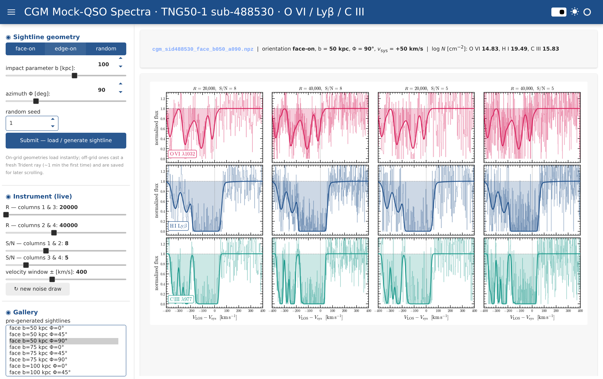

# CGM Mock-QSO Spectra — TNG50-1 subhalo 488530

Mock quasar absorption-line spectroscopy through the circumgalactic medium (CGM) of TNG50-1
subhalo **488530** (a central, MW-mass galaxy: M₂₀₀c ≈ 1.6×10¹² M⊙, R₂₀₀c = 246 kpc, SFR ≈ 7 M⊙/yr).
Sightlines run from −R₂₀₀c to +R₂₀₀c through the CGM at a chosen orientation, impact parameter,
and azimuth; **Trident** casts the ray and produces absorption spectra for three UV lines:

| ion       | line        | rest λ (Å) |
|-----------|-------------|------------|
| **O VI**  | O VI 1032   | 1031.912   |
| **H I**   | Ly β        | 1025.722   |
| **C III** | C III 977   | 977.020    |

Two deliverables:

1. **Publication 3×4 figure** — 3 rows (the three ions) × 4 instrument setups, x-axis
   `V_LOS − V_sys`. Setups: `(R, S/N) = (20000,8) (40000,8) (20000,5) (40000,5)`.
2. **Interactive Panel + Bokeh GUI** — live sliders for the two S/N and two R values,
   orientation / impact / azimuth controls, a scrollable gallery of pre-generated sightlines,
   on-demand ray generation, and one-click 240-dpi PDF/PNG export.



## Key design: R and S/N are post-processing

Ray-casting (Trident) is the only expensive step. Each sightline is generated **once** as a
high-resolution, **noiseless** optical-depth spectrum per ion. Spectral resolution and noise are
then applied instantly as arithmetic on the cached arrays (`scripts/degrade.py`):

- **Resolution R** → Gaussian LSF with FWHM = λ₀/R (⇒ velocity FWHM = c/R: R=20000→15 km/s,
  R=40000→7.5 km/s), sampled at **5 pixels per resolution element**.
- **S/N** → Gaussian noise defined **per resolution element**: per-pixel σ = √5 / (S/N).
- x-axis velocity: `V = c(λ/λ₀ − 1) − V_sys`, with `V_sys = SubhaloVel · n_los`.

So the GUI's R/S/N sliders and the four figure columns are all instant; only a *new geometry*
casts a fresh ray.

## Geometry

Built in the galaxy's **cold-gas disk frame** (`Lhat, xhat, yhat` from the OVI_CGM_compare
orientation cache). Azimuth convention: **Φ=0 = projected major axis** (disk plane),
**Φ=90 = projected minor axis** (polar). `face-on` looks down `Lhat`; `edge-on` looks along
`xhat`; `random` draws a seeded random line of sight. See `scripts/cgm_geometry.py`.

## Validation

Synthetic O VI columns (∫ n_OVI dl along each ray) match the **independent** OVI_CGM_compare
azimuthally-averaged radial profile for the same subhalo to **0.04–0.14 dex** at every impact
parameter (`figures/validate_ovi_columns.png`), with physical azimuthal scatter (minor-axis
outflow enhancement: at b=50, logN spans 13.9 major → 14.8 polar). The residual is consistent
with the known ~0.07 dex oxygen-metallicity systematic. `scripts/validate_ovi.py`.

## Layout

```
cgm_qso_488530/
  galaxy_488530.json            center, R200c, SubhaloVel, Lhat/xhat/yhat, cutout path, lines
  scripts/
    cgm_geometry.py             (orientation, b, Φ) -> ray endpoints (ckpc/h) + v_sys + n_los
    gen_cgm_sightlines.py       load cutout once, add ion fields, cast rays, high-res noiseless spectra
    degrade.py                  LSF(R) + noise(S/N per res-element); shared by figure and GUI
    make_publication_figure.py  the 3x4 figure (matplotlib, publication style, no title)
    validate_ovi.py             O VI column sanity-check vs OVI_CGM_compare radial profile
    score_sightlines.py         rank sightlines by multi-component + unsaturated ("showcase")
    demo_resolution_snr.py      pedagogical R / S-N / pixels-per-resolution-element explainer
    cgm_style.py                self-contained publication style + per-ion colours/labels
  data/
    sightlines/  cgm_sid488530_<geomid>.npz   high-res noiseless tau(lambda) per ion + geometry + v_sys
    grid_index.csv                            catalog: geom_id, orientation, b, azimuth, logN, + showcase scores
    showcase_ranking.csv                      sightlines ranked by showcase score (best demonstrators first)
  app/
    cgm_app.py                  Panel + Bokeh interactive GUI
  figures/                      exported 240-dpi PDF/PNG + GUI screenshots
```

## Usage

All commands use the `trident` conda env
(`<trident-env>/bin/python`).

**Generate sightlines** (loads the 5.5 GB cutout once):
```bash
export PYTHONPATH=$PWD/scripts HDF5_USE_FILE_LOCKING=FALSE MPLBACKEND=Agg
python scripts/gen_cgm_sightlines.py validate     # ~30 sightlines (O VI sanity grid)
python scripts/gen_cgm_sightlines.py full          # full grid (b×orient×azimuth + randoms)
python scripts/gen_cgm_sightlines.py more          # +300 random LOS, b 65-195 kpc (unsaturated, multi-component)
python scripts/gen_cgm_sightlines.py inner         # +200 random LOS, b < 50 kpc (dense inner CGM, often saturated)
python scripts/gen_cgm_sightlines.py one edge-on 100 90   # a single sightline
```

The dataset currently holds **672 sightlines** (incl. 200 inner-CGM random LOS at b < 50 kpc). To
find the best demonstrators — sightlines with
**multiple resolved, unsaturated velocity components** (where the effect of R and S/N is clearest;
saturated black cores look identical at every R and S/N) — rank them:
```bash
python scripts/score_sightlines.py --render 6   # writes showcase_ranking.csv + renders top-6 figures
```
This scores each ion (component count + how far the cores are from saturation) on the R=40,000
model, weights O VI most, and merges the scores into `grid_index.csv`. Good all-ion example:
`edge_b100_a330` (O VI/H I/C III all detectable and unsaturated).

**Publication figure** (one sightline):
```bash
python scripts/make_publication_figure.py edge_b100_a090   # -> figures/spectra_edge_b100_a090.{pdf,png}
python scripts/make_publication_figure.py face_b050_a090 20000 40000 8 5   # explicit R_lo R_hi SN_hi SN_lo
python scripts/make_publication_figure.py face_b050_a090 intrinsic   # also overlay the intrinsic (unconvolved) spectrum
```

Each panel shows the **noisy mock observation** (thin faint step) and the **noiseless model at
that column's resolution R** (thick colored curve). Adding `intrinsic` (or ticking the box in the
GUI) overlays the **intrinsic, unconvolved** spectrum (faint grey) — the R-independent "truth" that
sits behind all four columns, so you can see how much each R blurs away.

**Validation figure:**
```bash
python scripts/validate_ovi.py     # -> figures/validate_ovi_columns.{pdf,png}
```

**Interactive GUI:**
```bash
panel serve app/cgm_app.py --show --port 8050 \
  --allow-websocket-origin=127.0.0.1:8050 --allow-websocket-origin=localhost:8050
```
Open `http://127.0.0.1:8050/cgm_app` (auto-forwarded by the VS Code tunnel). The R/S/N sliders,
velocity window, **show intrinsic (unconvolved) spectrum** checkbox, and gallery selection
re-render instantly. The gallery is **sorted by showcase score** and **★-marks** the best
demonstrators (★ = O VI multi-component & unsaturated); the **★ showcase only** checkbox filters
to just those. **Submit** loads an on-grid geometry from cache or casts a fresh Trident ray
(~1 min the first time) and saves it into `data/sightlines/` + `grid_index.csv` so it becomes
scrollable. **Download PDF/PNG** exports the exact publication figure at 240 dpi.

## Standalone explorer (for sharing — one double-clickable file)

`delivery/` builds a **single self-contained `CGM_Explorer.html`** that reproduces the whole viewer
in a web browser — **pixel-identical to the live app**, because it runs the *actual* Python modules
(`cgm_style`, `degrade`, `make_publication_figure`) in-browser via **Pyodide/WebAssembly**. All 472
spectra (their τ arrays) are embedded, and the R / S/N / intrinsic controls re-run the real
`build_figure()`. Ideal for handing to a collaborator who just double-clicks it on macOS/Windows.
```bash
python scripts/export_web_data_wasm.py   # -> delivery/_webdata_wasm.json (τ arrays, float16)
python scripts/build_delivery_wasm.py    # inlines the 3 modules + data -> delivery/CGM_Explorer.html (~13 MB)
```
Needs internet the *first* time it is opened (it downloads the Pyodide runtime + numpy/matplotlib/
astropy from a CDN, ~10 s); after that it runs locally, ~1 s per redraw. `delivery/README.txt` is
the short non-technical guide bundled for the recipient; `delivery/CGM_Explorer_sub488530.zip` is
the ready-to-send package (HTML + README).

## Trident details

`trident.make_simple_ray` with endpoints in `code_length` (= ckpc/h); a custom
`SpectrumGenerator(lambda_min, lambda_max, dlambda=0.002 Å)` per line; and
`make_spectrum(..., use_peculiar_velocity=True, use_doppler_redshift_only=True, ly_continuum=False)`
— i.e. **Doppler-only** line-of-sight velocities (peculiar velocity, no cosmological/Hubble
redshift across the ray), as requested. Requires the editable Trident fork at `~/src/trident`
(v1.4.2) which provides the `use_doppler_redshift_only` flag.
