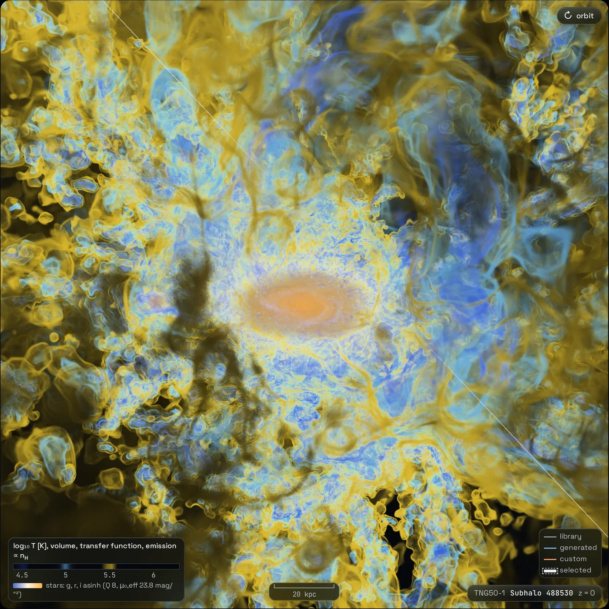
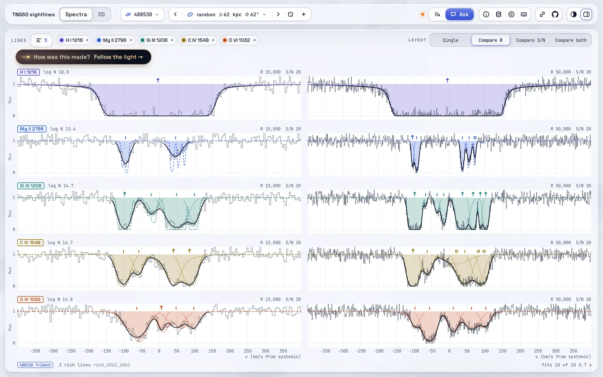
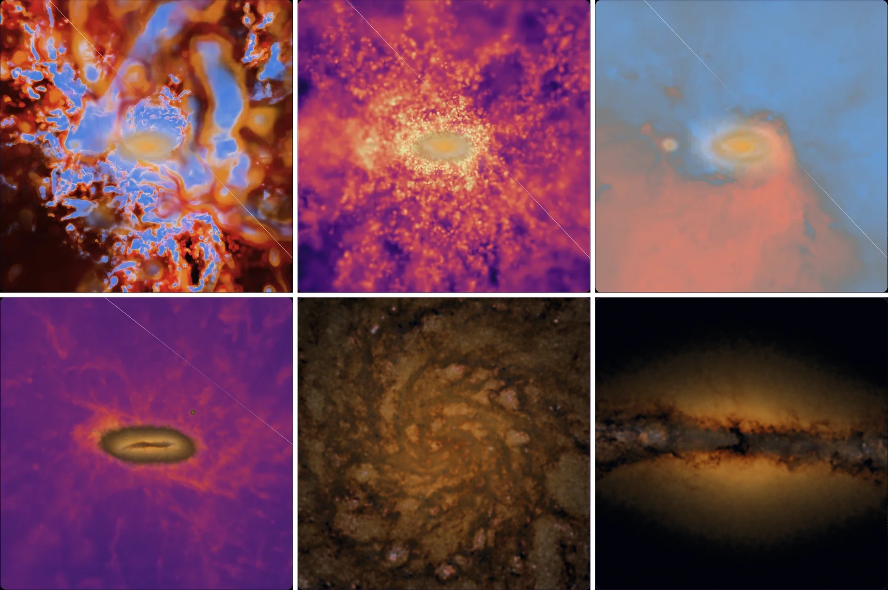
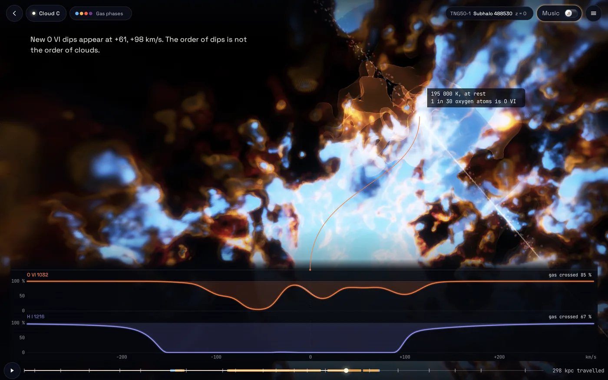
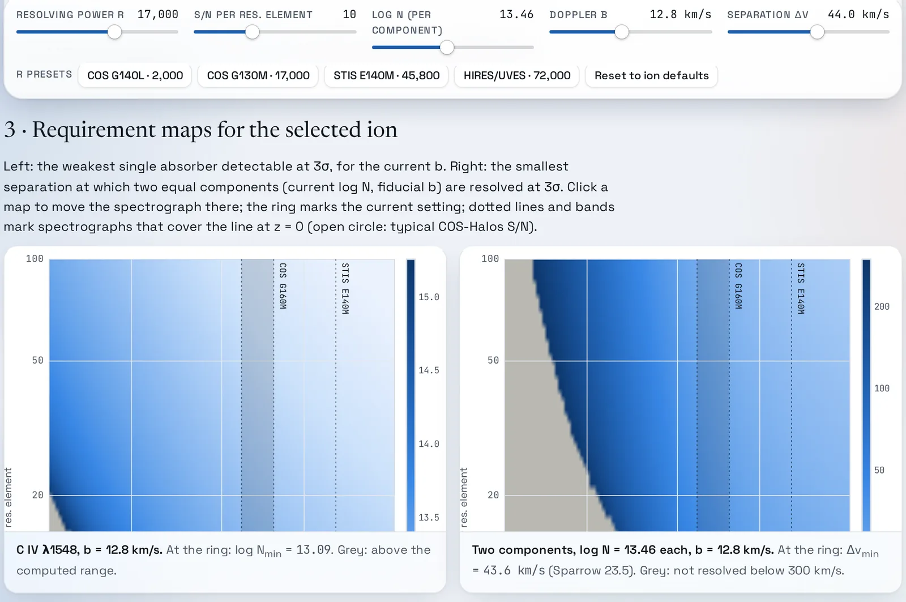
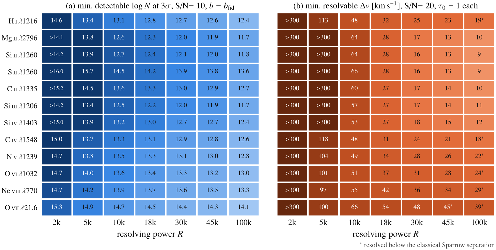

<p align="center">
  <a href="https://galaxies.tanmaysingh.uk/?tf=T~B4.5_0.03_0.25_2341af~B5_0.03_0.35_64b9ff~B5.5_0.03_0.5_ffd732~EnH_1~W4.4_6.3~FT#id=rand_b062_a062&ions=HI,MgII,SiIII,CIV,OVI&lay=1&R=uv:15000,50000;euv:15000,50000;xray:300,3000&sn=20,5&vc=0&vw=400&seed=0&fit=1&intr=1&tab=3d"></a>
</p>
<p align="center"><sub>Gas around TNG50-1 galaxy 488530 coloured by temperature, as the explorer's 3D view shows it at <a href="https://galaxies.tanmaysingh.uk/?tf=T~B4.5_0.03_0.25_2341af~B5_0.03_0.35_64b9ff~B5.5_0.03_0.5_ffd732~EnH_1~W4.4_6.3~FT#id=rand_b062_a062&ions=HI,MgII,SiIII,CIV,OVI&lay=1&R=uv:15000,50000;euv:15000,50000;xray:300,3000&sn=20,5&vc=0&vw=400&seed=0&fit=1&intr=1&tab=3d">this link</a>.</sub></p>

> [!NOTE]
> Under active development — we would love to hear your [ideas, feedback or bugs](https://github.com/tanmay-starslab/cgm-absorber-requirements/issues)!

<h1 align="center">Seeing the Circumgalactic Medium</h1>

<p align="center"><b>Shine a beam of light through a simulated galaxy's halo and read what the gas leaves behind.</b></p>

<p align="center">
  <a href="https://galaxies.tanmaysingh.uk/"><b>Try it in your browser &rarr;</b></a>
</p>

<p align="center">
  <a href="https://galaxies.tanmaysingh.uk"></a>
  <a href="https://github.com/tanmay-starslab/cgm-absorber-requirements/actions/workflows/ci.yml"></a>
  <a href="https://github.com/tanmay-starslab/cgm-absorber-requirements/releases"></a>
  <a href="LICENSE"></a>
  <a href="https://www.tng-project.org/data/"></a>
  <a href="http://flathub.flatironinstitute.org/fire"></a>
</p>

Every galaxy sits inside a vast, faint halo of gas, the circumgalactic medium. We only see it when a distant quasar
shines through: each kind of atom bites its own dip out of the light, and those dips tell us how much gas there is,
how hot it is and how it moves. This site lets you do that across **221 simulated galaxies at z = 0**: **198 Milky Way and M31 analogues** from the IllustrisTNG **TNG50-1** simulation and **23 cosmological zoom-in halos** from **FIRE-2** (Latte Milky Way hosts, ELVIS on FIRE Local Group pairs and Core dwarfs).

## What you can do

### Read the light

<p align="center"><a href="https://galaxies.tanmaysingh.uk/"></a></p>
<p align="center"><sub>Twelve ions along any sightline, through the telescope you choose.</sub></p>

### Fly through the gas

<p align="center"></p>
<p align="center"><sub>Colour the halo by temperature, any ion, velocity or density, and turn it any way you like.</sub></p>

### Watch a spectrum form

<table>
  <tr>
    <td width="50%"><a href="https://galaxies.tanmaysingh.uk/learn/how-a-spectrum-is-made/"></a></td>
    <td width="50%"></td>
  </tr>
</table>
<p align="center"><sub>Follow one beam cell by cell, from gas to a fitted spectrum.</sub></p>

### Take it anywhere

<p align="center"></p>
<p align="center"><sub>Works on a phone, nothing to install.</sub></p>

## Three ways in

- [**Explorer**](https://galaxies.tanmaysingh.uk/) for sightlines, spectra and 3D gas.
- [**How an absorption spectrum is made**](https://galaxies.tanmaysingh.uk/learn/how-a-spectrum-is-made/) for the story.
- [**Detect & Resolve**](https://galaxies.tanmaysingh.uk/requirements/) for what a telescope needs to see it.

## Credit and feedback

No formal citation needed; a link to https://galaxies.tanmaysingh.uk is kindly appreciated. The simulation and tools
have their own citation requests under [Credits](#credits). Found a bug or have an idea? Open an
[issue](https://github.com/tanmay-starslab/cgm-absorber-requirements/issues) or see [CONTRIBUTING.md](CONTRIBUTING.md).

---

## Technical details

| Page | Source |
|---|---|
| Explorer | `docs/tng50/` ([below](#tng50-sightline-explorer)) |
| How an absorption spectrum is made | `docs/tng50/learn/` ([below](#learn-page-how-an-absorption-spectrum-is-made)) |
| Detect & Resolve | `docs/index.html`, `absreq/`, `paper/` |

Detect & Resolve asks what S/N and resolving power it takes to **detect** a circumgalactic absorber and to
**resolve** it into velocity components. Old `tanmay-starslab.github.io/cgm-absorber-requirements/...` links
redirect to the new site.

<details>
<summary><b>Detect &amp; Resolve: method, transitions and figures</b></summary>

### Detect & Resolve

<p align="center"></p>



### Transitions

| Ion | λ [Å] | f | b_fid [km/s] | log N(τ₀=1) | Source |
|---|---|---|---|---|---|
| H I | 1215.67 | 0.416 | 13.8 | 13.26 | Trident |
| Mg II | 2796.35 | 0.6155 | 5.6 | 12.34 | Morton (2003) |
| Si II | 1260.42 | 1.18 | 5.6 | 12.40 | Trident |
| S II | 1259.52 | 0.0182 | 5.5 | 14.20 | Trident |
| C II | 1334.53 | 0.129 | 6.2 | 13.38 | Trident |
| Si III | 1206.50 | 1.63 | 6.5 | 12.35 | Trident |
| Si IV | 1402.77 | 0.255 | 7.8 | 13.16 | Trident |
| C IV | 1548.19 | 0.190 | 12.8 | 13.46 | Trident |
| N V | 1238.82 | 0.156 | 16.2 | 13.75 | Trident |
| O VI | 1031.91 | 0.133 | 18.4 | 13.95 | Trident |
| Ne VIII | 770.41 | 0.102 | 22.8 | 14.29 | Trident |
| O VII | 21.602 | 0.696 | 32.6 | 15.16 | Verner et al. (1996) |

Atomic data are read from the [Trident](https://github.com/trident-project/trident) line list
(`absreq/data/trident_lines.txt`, BSD-3). Mg II λ2796/2803, Si IV λ1393 and O VII λ21.6 are not in that
list and come from `absreq/data/supplement_lines.txt`, which records the source of each value.
The fiducial b is the thermal width at a representative temperature plus 5 km/s turbulence.

### Method in one paragraph

Doppler-core profiles are convolved with a Gaussian line-spread function of FWHM c/R. Detection uses the
matched-filter significance S_det = (S/N)·[∫D² dv / FWHM]^½. Separation uses the expected Δχ² of the best
single-component fit to a two-component truth, S_res = (S/N)·√G. Both are linear in S/N, so each
four-parameter problem is one precomputed 3-D cube. In the optically thin limit the resolution problem
is universal: Δv_min ≈ 1.98 FWHM_eff S_det^(−1/4) for equal pairs, with FWHM_eff² = (c/R)² + (1.665 b)².
See `paper/detectability_note.pdf`.

### HST/COS line-spread function (option)

The published grids, figures and table use the Gaussian LSF. A second LSF, the tabulated HST/COS optical-model LSF
from STScI, is available next to it (`absreq/lsf.py`; tables and provenance in `absreq/data/cos_lsf/`):
`lsf.gaussian(R)` reproduces the Gaussian path bit for bit, `lsf.cos(grating, cenwave, lp, lam)` builds the COS kernel
at an observed wavelength (columns interpolated linearly in wavelength, pixels put on velocity with the DISPTAB
dispersion). The COS LSF has one resolution per setting, so its grids replace the R axis by the setting:
`grids/cos/<key>_<setting>.npz` holds K and G for the COS kernel and for a Gaussian of the same FWHM, for the ten
transitions COS reaches at z = 0 (O VI 1032 only with the blue modes G130M/1055 and 1096 at LP2; Mg II 2796 with
G285M/2676; Ne VIII and O VII are out of range). S/N is per FWHM of the LSF core (R_eff = c/FWHM); the 6-pixel resel
is about 0.7 FWHM for G130M/G160M, so S/N per 6-pixel resel = 0.82 x S/N per FWHM there.

At the same FWHM the broad wings cost 0.07-0.15 dex in log N_min (S/N = 10) and raise Δv_min by 1.2-1.5x
(S/N = 20, two τ0 = 1 components) for G130M/1291 and G160M/1577 (`grids/cos/summary.csv`, `paper/cos_lsf_table.tex`,
`figures/cos_lsf.pdf`). The NUV model LSF is about 2 pixels wide (R ≈ 35,000 at 2796 Å), narrower than the empirical
20,000-24,000 in the COS Instrument Handbook, so treat the Mg II numbers with care.

### Instrument markers

`absreq/data/instruments.json` lists real spectrographs (HST/COS G130M and G160M, HST/STIS E140M, E140H, E230M,
E230H, FUSE) with R, wavelength coverage, LSF type, status and a source for every number (COS and STIS instrument
handbooks, Sahnow et al. 2000, COS-Halos S/N from Tumlinson et al. 2013). The instrument-plane figures and the
Detect & Resolve maps mark the ones that cover each line at z = 0: a dotted line at R, a shaded band for an R range,
an open circle at the reference S/N. R above 10^5 is named in the figure legend. The LUVOIR/LUMOS concept (France
et al. 2017) is listed with `show: false`. A `proposed` entry is also hidden: fill in its name, label, wavelength
range, R (and S/N) with sources and set `show: true`, and it appears in orange on the next `make_figures.py ions`
and `export_web_data.py` run. `tests/test_instruments.py` checks the file.


</details>

<details>
<summary><b>TNG50 &amp; FIRE-2 sightline explorer: data, fitting, 3D, chat and deployment</b></summary>

### TNG50 & FIRE-2 sightline explorer

The explorer applies the same instrument question to simulated absorbers across **221 galaxies at z = 0**:
- **198 IllustrisTNG TNG50-1 Milky Way and M31 analogues** (snapshot 99; Nelson et al. 2019a,b; Pillepich et al. 2019, 2024). Subhalo 488530 has 672 Trident quasar sightlines plus on-demand ray generation; the other 197 analogues carry 700 sightlines each traced through the Voronoi mesh with THOR (Byrohl & Nelson 2025) and CLOUDY FG11 ion fractions.
- **23 FIRE-2 cosmological zoom-in halos** (snapshot 600; Hopkins et al. 2018; Wetzel et al. 2023): 8 Latte Milky Way-mass hosts (`m12b`, `m12c`, `m12f`, `m12i`, `m12m`, `m12r`, `m12w`, `m12z`; Wetzel et al. 2016; Garrison-Kimmel et al. 2017; Samuel et al. 2020), 6 ELVIS on FIRE Local Group MW+M31 paired hosts (`Romeo` & `Juliet`, `Romulus` & `Remus`, `Thelma` & `Louise`; Garrison-Kimmel et al. 2019), and 9 Core dwarf halos (`m11b`, `m11d`, `m11e`, `m11h`, `m11i`, `m11q`, `m10q`, `m10v`, `m09`; Chan et al. 2018; El-Badry et al. 2018), each with 120 Trident sightlines (face-on, edge-on and random orientations across impact parameters up to R200c) and fitted Voigt component catalogues.
- **Simulation switcher & galaxy picker.** A top-bar `TNG50 | FIRE-2` segmented choice switch (also visible on Android and iPhone) jumps between simulations, and the galaxy picker groups all 221 galaxies by simulation with instant search and sorting by stellar mass, halo mass, SFR, central or satellite.

- **Lines (Phase 3).** Twelve ions ordered by ionisation potential, from cool to hot: H I 1216 (Lyα), Mg II 2796,
  Si II 1260, C II 1335, Si III 1206, C III 977, Si IV 1403, C IV 1548, N V 1239, O VI 1032, Ne VIII 770 and
  O VII 21.6. One registry, `tngsight/ions.json`, holds the atomic data (Trident's values; O VII from
  `absreq/data/supplement_lines.txt`), colours, bands, R ranges and fitter limits; Python, the server, the page and
  the chat tools all derive from it.
- **Data v2.** Each line has its own constant-velocity grid, 0.25 km/s over ±1500 km/s (up to ±10,000 km/s for
  damped H I), stored as npz v2; the page reads the TNGS v2 binary (1 km/s, u16 transmission, lines keyed by registry
  key). The velocity axis is V = c(λ/λ₀ − 1) + v_sys, so the galaxy sits at V = 0. The library was regenerated from
  the slim cutout with the same rays (`deploy/data/regen_library.py`), with a slim ion table that now holds H, C, N,
  O, Ne, Mg and Si.
- **Degrading.** In the browser, with a Gaussian LSF of FWHM = c/R in velocity. R is a slider per band (UV and EUV
  5,000 to 150,000, X-ray 100 to 5,000), S/N runs from 2 to 100, and the layout shows one case, two cases varying R
  or S/N, or the 2×2 grid.
- **In-browser fitter.** "Fitted components" fits the noisy, degraded spectrum of every displayed case in a Web
  Worker: Levenberg–Marquardt on (log N, b, v) through the LSF, seeded from the intrinsic components, with
  insignificant components pruned by ΔBIC and results cached per (sightline, ion, R, S/N, seed).
- **Intrinsic components.** `tngsight/vpfit.py` (clean-room; scipy `wofz` + `least_squares`) fits the noiseless
  native spectra with a pseudo-noise σ = 0.01, so its errors are formal. Fit regions are seeded per pixel and by a
  matched filter (box widths 3 to 127 km/s; the library was refitted with it), which also finds shallow, broad O VI,
  N V and Ne VIII. Flags: 1 SAT, 2 BOUND, 4 MAXCOMP, 8 POORFIT, 16 EDGE, 32 NOERR, 64 DAMPED, 128 BUDGET.
- **3D tab (5-level nested octree + 3D dust radiative transfer).** For all 221 TNG50 and FIRE-2 galaxies, every gas cell
  or particle is deposited with its SPH/Voronoi kernel onto **five nested 256³ cubes** (L0 ±400 kpc, L1 ±100 kpc,
  L2 ±25 kpc, L3 ±6.25 kpc, and L4 ±1.5 kpc at **12 pc voxel resolution**) of n_H, T, Z, v_x, v_y, v_z and all 12 ion
  densities, next to crisp 5-level stellar g, r, i light cubes (S0..S4, Lupton et al. 2004 asinh composite with
  3D cold-gas dust opacity `q_dust` packed in the alpha channel and selectable SKIRT 2-component, Calzetti+00,
  Cardelli+89 and FIRE Studio Pei+92 extinction curves). Velocity views (v_los, v_r, v_φ, |v|, σ_los)
  are derived per frame from stored mass-weighted velocity cubes in the galaxy rest frame. The public datasets live on Hugging Face at
  [`tanmay-starslab/tng50-sub488530-viz`](https://huggingface.co/datasets/tanmay-starslab/tng50-sub488530-viz),
  [`tanmay-starslab/tng50-mwm31-web-0`..`3`](https://huggingface.co/datasets/tanmay-starslab/tng50-mwm31-web-0) and
  [`tanmay-starslab/fire2-core-web-0`..`3`](https://huggingface.co/datasets/tanmay-starslab/fire2-core-web-0);
  git keeps only the pinned `manifest_v2.json` and the LUTs. If huggingface.co is unreachable, everything except the
  3D stage keeps working.
- **Find and Ask.** A deterministic component search (identical JS and Python versions), and an **Ask** chat panel that
  drives all 10 page tools across the 221 TNG50 and FIRE-2 galaxies (`list_galaxies`, `select_galaxy`,
  `search_sightlines`, `select_sightline`, `set_instrument`, `show_3d`, `set_view`, `get_page_state`,
  `request_sightline`, `request_custom_ray`). When the sightline server is online with an Anthropic key it uses the
  stateless Claude proxy; when offline on the static site it runs an instant built-in browser assistant (with optional
  WebLLM Qwen2.5-1.5B local WebGPU model). Answers whose numbers do not come from a tool result get an "unverified" badge.

```
 Cloudflare: docs/tng50/                backend (Docker): server.app             laptop
 static page + library (.bin)           coordinator + fallback compute          ────────────────────
 ───────────────────────────            ───────────────────────────────          serve.sh  127.0.0.1:8787
 degrades and fits in the browser       job queue, SSE progress, figures         (local page backend)
 POST /api/sightlines  ───────────────▶ canonicalize → library hit?  ◀─ lease ── worker.sh: pulls jobs
 SSE /api/jobs/{id}/events ◀─────────── progress / done                ── result ▶ over HTTPS, computes
 GET /api/sightline/{id}.bin ◀───────── npz → web binary                          on the slim cutout
                                        HFSync ⇄ private HF dataset (generated/)
```

- **Site:** https://galaxies.tanmaysingh.uk, a static Cloudflare Worker (`wrangler.jsonc`) built by
  `scripts/build_site.mjs` into `dist/`. Every push to `main` redeploys it.
- **API backend:** the `deploy/hf_space` image, on an Oracle Cloud VM (`deploy/oci/`) or as an HF Docker Space
- **Data:** private HF dataset `tanmay-starslab/tng50-sub488530-cgm` (slim cutout, slim ion table, library)

The page always loads the static library from its own `data/`, so it works with no backend. It probes
`http://127.0.0.1:8787` and then the configured backend, and uses the first healthy one for new sightlines and
publication figures. Run it locally, with every default path under the work root `$TNG_WORK`:

```bash
pip install -r requirements-tng.txt     # plus trident (patched) and yt_astro_analysis: see deploy/hf_space/Dockerfile
deploy/laptop/serve.sh                  # backend on 127.0.0.1:8787
(cd docs && python3 -m http.server 8000)        # then open http://127.0.0.1:8000/tng50/
```

[`docs/TNG50_OPERATIONS.md`](docs/TNG50_OPERATIONS.md) has the rebuild steps (slim ion table, library regeneration,
component refit, 3D cubes and their column checks), the upload and deploy steps from a clean worktree, the tests,
running on a Linux cluster, and the known limitations:

- H I Lyα uses Trident's Γ = 4.69e8 s⁻¹; the usual damping constant is 6.265e8 (Morton 2003), so damped log N here
  sits about 0.13 dex from VPFIT-style tools.
- Saturated components, including Lyα-only H I fits in the degenerate range, are shown, searched and reported as lower
  limits (log N ≥ x).
- The Phase 1/2 (v1) spectra carry a Trident bin-edge offset of up to 0.45 dλ for narrow lines; it conserves ∫τ dv.
- The 3D cubes are checked against their own smoothed, voxel-averaged field (≤ 0.05 dex), not against a thin ray.

The original app and its scripts are in `tng50/` (see
[`tng50/README.md`, "Corrections (2026-10)"](tng50/README.md#corrections-2026-10-velocity-frame-and-dλ) for its
velocity-frame and dλ fixes). Layout: `tngsight/` (registry, geometry, generator, npz and web formats, fitter, cubes),
`server/` (FastAPI), `deploy/` (data builds, HF Space, VM and laptop scripts).


</details>

<details>
<summary><b>How an absorption spectrum is made: the story page and its build</b></summary>

#### Learn page: How an absorption spectrum is made

`docs/tng50/learn/how-a-spectrum-is-made/` tells how one sightline's spectrum is built: the light behind the galaxy,
the gas cells along the beam, which ions absorb, one cell's dip, Doppler shifts, the sum of many cells, saturation,
the instrument's blur, noise and the Voigt fit. It reads as a page of steps (scroll or arrow keys), plays as a film
(Play) and opens a few live controls per step (Try it); the last step hands the same sightline to the explorer. The
story is galaxy-agnostic: `?g=<subhalo>` picks a galaxy, and the explorer's links ("How is this made?" under the
spectra, and the chapter list in How to read) pass the galaxy on screen. Each galaxy needs its story file in
`learn/how-a-spectrum-is-made/data/` (listed in `data/index.json`); a galaxy without one falls back to the default
story with a note. The physics is the explorer's own (`docs/tng50/js/fit.js`).

```bash
GALAXIES="488530 411449" RAY=rand_b062_a062 sbatch --array=0-1 scripts/story_data.sbatch
                                                  # story data per galaxy (export_story_data.py cells + build,
                                                  # precomputed fits from story_fits.mjs); any of the 198 hosts
python3 scripts/story_page.py                     # writes the page text from steps.json
scripts/story_equations.sh                        # equation SVGs (latex + dvisvgm)
node scripts/story_vtt.mjs; sbatch scripts/story_render.sbatch    # captions, then the film (HyperFrames)
node tests/js/run_all.mjs story                   # story gates (TNG_BROWSER=1 for the browser ones)
```

`scripts/export_tng50_web.py --out DIR` copies `learn/` along with the page, without `build/` and the film MP4s,
which are hosted outside the repository.


</details>

<details>
<summary><b>Repository layout and how to reproduce</b></summary>

### Layout

```
absreq/        lines.py · profiles.py · detection.py · separation.py · theory.py · style.py
scripts/       build_grids.py → grids/   make_figures.py → figures/   make_tables.py → paper/   export_web_data.py → docs/
figures/       lsf_resolution, requirements_matrix, ions/<ion>_{instrument,absorber}_plane  (PDF + PNG)
paper/         detectability_note.tex/.pdf
docs/          Detect & Resolve page (index.html); docs/tng50/ explorer and the learn page
tngsight/ server/ deploy/ tng50/   TNG50 explorer: library, API server, deployment, original app
tests/         analytic limits and thin-line agreement
```

### Reproduce

```bash
pip install -r requirements.txt          # LaTeX with txfonts + dvipng needed for the figures
python -m pytest tests
PYTHON=$(which python) node tests/js/run_all.mjs   # JS tests (explorer page, 3D data decode, LUTs, LOD, picker, search, chat)
python scripts/build_grids.py            # ~1-2 min per ion on 2 cores
python scripts/make_figures.py
python scripts/build_cos_grids.py && python scripts/build_cos_grids.py --table   # COS LSF option, ~2 min
python scripts/make_figures.py cos
python scripts/make_tables.py && (cd paper && pdflatex detectability_note.tex)
python scripts/export_web_data.py
```


</details>

### Caveats

Gaussian LSF for the published numbers (the HST/COS LSF has broad wings, so COS-like numbers are optimistic; see the
COS LSF option above for how much); Doppler cores only;
equal components at the fiducial b; expected (median) significances; S/N per resolution element with
constant continuum noise. Nominal instrument resolving powers are indicative.

## Credits

- **IllustrisTNG (TNG50-1 at z = 0, snapshot 99, 198 MW/M31 analogues):** Nelson et al. 2019a, ComAC 6, 2, [doi:10.1186/s40668-019-0028-x](https://doi.org/10.1186/s40668-019-0028-x);
  Nelson et al. 2019b, MNRAS 490, 3234, [doi:10.1093/mnras/stz2306](https://doi.org/10.1093/mnras/stz2306); Pillepich et al. 2019, MNRAS 490, 3196, [doi:10.1093/mnras/stz2338](https://doi.org/10.1093/mnras/stz2338); Pillepich et al. 2024, MNRAS 535, 1721, [doi:10.1093/mnras/stae2125](https://doi.org/10.1093/mnras/stae2125);
  data from https://www.tng-project.org/data/, used as the TNG Collaboration requests.
- **FIRE-2 cosmological zoom-in simulations (z = 0, snapshot 600, 23 halos):** public data release (Wetzel et al. 2023, ApJS 265, 44, [doi:10.3847/1538-4365/acb99a](https://doi.org/10.3847/1538-4365/acb99a); http://flathub.flatironinstitute.org/fire and https://fire.northwestern.edu/data/), run with GIZMO (Hopkins 2015, MNRAS 450, 53, [doi:10.1093/mnras/stv195](https://doi.org/10.1093/mnras/stv195)) and the FIRE-2 physics model (Hopkins et al. 2018, MNRAS 480, 800, [doi:10.1093/mnras/sty1690](https://doi.org/10.1093/mnras/sty1690)): Latte Milky Way-mass hosts `m12b..m12z` (Wetzel et al. 2016, ApJL 827, L23, [doi:10.3847/2041-8205/827/2/L23](https://doi.org/10.3847/2041-8205/827/2/L23); Garrison-Kimmel et al. 2017, MNRAS 471, 1709; Samuel et al. 2020, MNRAS 491, 1471), ELVIS on FIRE Local Group pairs `Romeo` & `Juliet`, `Romulus` & `Remus`, `Thelma` & `Louise` (Garrison-Kimmel et al. 2019, MNRAS 487, 1380, [doi:10.1093/mnras/stz1317](https://doi.org/10.1093/mnras/stz1317)), and Core dwarf halos `m11b..m09` (Chan et al. 2018, MNRAS 478, 906, [doi:10.1093/mnras/sty1153](https://doi.org/10.1093/mnras/sty1153); El-Badry et al. 2018, MNRAS 473, 1930).
- **Spectra and 3D cubes:** Spectra of the 197 TNG50 MW/M31 analogues from the fiducial ray library traced through the TNG50 Voronoi mesh with THOR (Byrohl & Nelson 2025, arXiv:2507.11603), ion fractions from CLOUDY (Ferland et al. 2017) with the FG11 UV background (Faucher-Giguère et al. 2009) and Rahmati et al. (2013) H I self-shielding. TNG50 galaxy 488530's default and custom rays, all 23 FIRE-2 sightline libraries, and every 3D ion cube: Trident (Hummels, Smith & Silvia 2017) on yt (Turk et al. 2011) with the HM2012 background (Haardt & Madau 2012). The star composite follows Lupton et al. (2004) with Bruzual & Charlot (2003) / FSPS stellar synthesis and 3D cold-gas dust extinction. The 3D viewer's approach (deposited cubes and column-integral rendering) was inspired by Scott Lucchini's TNG viewer. Explainer music (optional, two tracks): Hans Zimmer, Day One (Interstellar, 2014), and Beethoven, Symphony No. 7 in A major, Op. 92, II. Allegretto (orchestral recording); excerpted, faded and looped.

## Licence

Code: MIT, © 2026 Tanmay Singh ([`LICENSE`](LICENSE)). This covers all code here, including the
TNG50 and FIRE-2 explorer (`tngsight/`, `server/`, `deploy/`, `tng50/`, `docs/tng50/`).

Third-party terms ([`THIRD_PARTY_LICENSES`](THIRD_PARTY_LICENSES) has the full texts):

- **Trident** (BSD-3, © Trident Development Team): the line list `absreq/data/trident_lines.txt` is
  redistributed under its licence, and `deploy/hf_space/trident_doppler_only.patch` is derived from
  Trident source and is BSD-3, not MIT.
- **yt** (BSD-3, © yt Development Team): a dependency, not vendored.
- **three.js** (MIT), **WebLLM** (Apache-2.0) and the **Qwen2.5-1.5B-Instruct** weights (Apache-2.0)
  are loaded from their CDNs by the browser and are not vendored. pygad (GPL-2+) was only run
  out-of-tree to validate the fitter. None of its code is in this repository.
- **Learn page:** Space Grotesk and JetBrains Mono (SIL OFL 1.1) are vendored in
  `docs/tng50/learn/how-a-spectrum-is-made/vendor/` with their licence. The film is rendered with HyperFrames
  (Apache-2.0) and ffmpeg, build tools only, not vendored. No GSAP or Remotion.
- **uisfx** 0.4.0 (code MIT, sounds CC0): the optional UI sound effects runtime, vendored in
  `docs/tng50/vendor/uisfx/` with both licences.
- **MediaPipe Tasks Vision** 1.2.3 and the **Face Landmarker** model (Apache-2.0, © Google LLC): vendored in
  `docs/tng50/vendor/mediapipe/` with the licence and a README (versions, sources, sha256, the one change: the usage
  logger is disabled). Loaded only when a visitor starts head control in the 3D tab.
- **TNG50 and FIRE-2 data.** The TNG50-derived and FIRE-2-derived spectra, libraries, story data and 3D cubes (`docs/tng50/data/`, `docs/tng50/learn/*/data/`, the npz libraries, the
  private HF dataset and the public datasets `tanmay-starslab/tng50-mwm31-web-0` to `-3`, `tanmay-starslab/tng50-sub488530-viz`, and `tanmay-starslab/fire2-core-web-0` to `-3`)
  are not MIT and are not relicensed here. They are used as the IllustrisTNG Collaboration
  ([citation](https://www.tng-project.org/data/docs/background/#citation): Nelson et al. 2019a,b; Pillepich et al. 2019, 2024)
  and FIRE Collaboration ([citation](https://fire.northwestern.edu/data/): Hopkins 2015; Hopkins et al. 2018; Wetzel et al. 2016, 2023; Garrison-Kimmel et al. 2017, 2019; Samuel et al. 2020; Chan et al. 2018; El-Badry et al. 2018) request.
  Please also cite Trident (Hummels, Smith & Silvia 2017, ApJ 847, 59) and yt (Turk et al. 2011,
  ApJS 192, 9).
