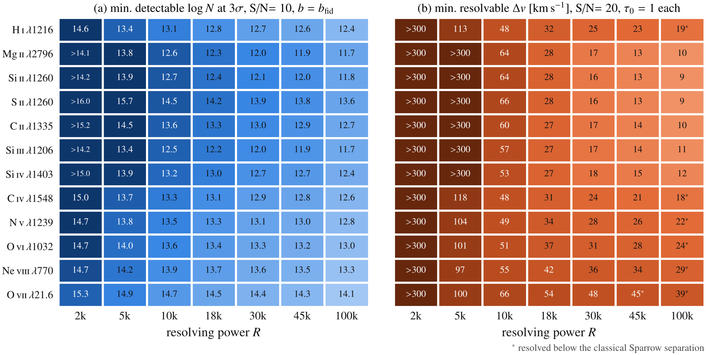

# cgm-absorber-requirements

What S/N and spectral resolving power does it take to **detect** a circumgalactic absorber, and to
**resolve** it into its velocity components? This repository answers both questions for twelve strong
CGM transitions, with publication figures, a technical note and an interactive explainer.

**Interactive explainer:** https://tanmay-starslab.github.io/cgm-absorber-requirements/ (source: `docs/index.html`)
· **TNG50 sightline explorer:** https://tanmay-starslab.github.io/cgm-absorber-requirements/tng50/ (see [below](#tng50-sightline-explorer))



## Transitions

| Ion | λ [Å] | f | b_fid [km/s] | log N(τ₀=1) | Source |
|---|---|---|---|---|---|
| H I | 1215.67 | 0.416 | 13.8 | 13.26 | Trident |
| Mg II | 2796.35 | 0.6155 | 5.6 | 12.34 | Morton (2003) |
| Si II | 1260.42 | 1.18 | 5.6 | 12.40 | Trident |
| S II | 1259.52 | 0.0182 | 5.5 | 14.20 | Trident |
| C II | 1334.53 | 0.129 | 6.2 | 13.38 | Trident |
| Si III | 1206.50 | 1.63 | 6.5 | 12.35 | Trident |
| Si IV | 1402.77 | 0.255 | 7.8 | 13.16 | Trident |
| C IV | 1548.19 | 0.190 | 12.8 | 13.46 | Trident |
| N V | 1238.82 | 0.156 | 16.2 | 13.75 | Trident |
| O VI | 1031.91 | 0.133 | 18.4 | 13.95 | Trident |
| Ne VIII | 770.41 | 0.102 | 22.8 | 14.29 | Trident |
| O VII | 21.602 | 0.696 | 32.6 | 15.16 | Verner et al. (1996) |

Atomic data are read from the [Trident](https://github.com/trident-project/trident) line list
(`absreq/data/trident_lines.txt`, BSD-3). Mg II λ2796/2803, Si IV λ1393 and O VII λ21.6 are not in that
list and come from `absreq/data/supplement_lines.txt`, which records the source of each value.
The fiducial b is the thermal width at a representative temperature plus 5 km/s turbulence.

## Method in one paragraph

Doppler-core profiles are convolved with a Gaussian line-spread function of FWHM c/R. Detection uses the
matched-filter significance S_det = (S/N)·[∫D² dv / FWHM]^½. Separation uses the expected Δχ² of the best
single-component fit to a two-component truth, S_res = (S/N)·√G. Both are linear in S/N, so each
four-parameter problem is one precomputed 3-D cube. In the optically thin limit the resolution problem
is universal: Δv_min ≈ 1.98 FWHM_eff S_det^(−1/4) for equal pairs, with FWHM_eff² = (c/R)² + (1.665 b)².
See `paper/detectability_note.pdf`.

## Layout

```
absreq/        lines.py · profiles.py · detection.py · separation.py · theory.py · style.py
scripts/       build_grids.py → grids/   make_figures.py → figures/   make_tables.py → paper/   export_web_data.py → docs/
figures/       lsf_resolution, requirements_matrix, ions/<ion>_{instrument,absorber}_plane  (PDF + PNG)
paper/         detectability_note.tex/.pdf
docs/          interactive explainer (GitHub Pages); docs/tng50/ TNG50 sightline explorer
tngsight/ server/ deploy/ tng50/   TNG50 explorer: library, API server, deployment, original app
tests/         analytic limits and thin-line agreement
```

## Reproduce

```bash
pip install -r requirements.txt          # LaTeX with txfonts + dvipng needed for the figures
python -m pytest tests
PYTHON=$(which python) node tests/js/run_all.mjs   # JS tests (explorer page, picker, search, chat)
python scripts/build_grids.py            # ~1-2 min per ion on 2 cores
python scripts/make_figures.py
python scripts/make_tables.py && (cd paper && pdflatex detectability_note.tex)
python scripts/export_web_data.py
```

## TNG50 sightline explorer

A second page applies the same instrument question to simulated absorbers. It holds 672 quasar
sightlines through the CGM of TNG50-1 subhalo 488530 at z = 0, in O VI 1032, H I Lyβ and C III 977.
You can degrade them to any pair of (R, S/N) setups in the browser, and request new geometries
(face-on, edge-on or random; impact parameter b ≤ 300 kpc; azimuth Φ). New geometries are cast with
yt + Trident on demand. The velocity axis is V = c(λ/λ₀ − 1) + v_sys, which puts the galaxy at V = 0.
The LSF is a Gaussian with FWHM = λ₀/R, with the kernel width set from the generation step
dλ = 0.002 Å (not the median pixel step of the float32 grid), so the FWHM is exact. See
[`tng50/README.md`, "Corrections (2026-10)"](tng50/README.md#corrections-2026-10-velocity-frame-and-dλ)
for both fixes and for which committed figures and CSVs predate them.

- **Page:** https://tanmay-starslab.github.io/cgm-absorber-requirements/tng50/ (source: `docs/tng50/`)
- **API backend (HF Space):** `https://<user>-<space>.hf.space` (placeholder until the Space is deployed)
- **Data:** private HF dataset `tanmay-starslab/tng50-sub488530-cgm` (slim cutout, slim ion table, library)

```
 GitHub Pages: docs/tng50/              HF Space (Docker): server.app            laptop
 static page + library (.bin)           coordinator + fallback compute          ────────────────────
 ───────────────────────────            ───────────────────────────────          serve.sh  127.0.0.1:8787
 renders spectra natively in JS         job queue, SSE progress, figures         (local page backend)
 POST /api/sightlines  ───────────────▶ canonicalize → library hit?  ◀─ lease ── worker.sh: pulls jobs
 SSE /api/jobs/{id}/events ◀─────────── progress / done                ── result ▶ over HTTPS, computes
 GET /api/sightline/{id}.bin ◀───────── npz → web binary                          on the slim cutout
                                        HFSync ⇄ private HF dataset (generated/)
```

The page always loads the static library from its own `data/`, so it works with no backend. It
probes `http://127.0.0.1:8787` and then the Space, and uses the first healthy one for generation and
for publication figures (`POST /api/figure`).

Run it locally (macOS setup with the work volume at `$WORK`, e.g. `WORK=/Volumes/cgm_work`):

```bash
pip install -r requirements-tng.txt     # plus trident (patched) and yt_astro_analysis: see deploy/hf_space/Dockerfile
deploy/laptop/serve.sh                  # backend on 127.0.0.1:8787
(cd docs && python3 -m http.server 8000)        # then open http://127.0.0.1:8000/tng50/
```

Phase 2 adds, in the same page:

- **3D tab.** Ray-marched gas volumes (n_H, T, Z, n(O VI), n(H I), n(C III)) on a 256³ grid over a
  ±400 kpc box around the galaxy, SPH-deposited from the slim cutout with the same ion table as the
  spectra (`tngsight/volume.py`, `deploy/data/build_volumes.py`; 128³ first, 256³ on desktop). three.js
  0.169.0 loads from jsdelivr only when the tab is first opened; it needs WebGL2. Face-on/edge-on presets
  use the disk frame. Clicking a line selects that sightline in both tabs.
- **Ray picking.** Pick two points in 3D, or type them in the six numeric fields (|p| ≤ 395 kpc,
  length 20–800 kpc, quantised to 0.1 kpc). `POST /api/sightlines/custom` casts the ray (id
  `cust_<sha1[:10]>`) through the same queue and SSE progress, and the spectrum opens when it is done.
- **Voigt components.** A clean-room fitter (`tngsight/vpfit.py`, scipy `wofz` + `least_squares`) fits
  the intrinsic native-grid spectra in the fixed V frame. It uses a pseudo-noise σ = 0.01 per pixel, so
  the quoted errors are **formal**, not observational. Flags: 1 SAT (logN effectively a lower limit), 2 BOUND,
  4 MAXCOMP, 8 POORFIT, 16 EDGE, 32 NOERR. Library fits ship in `docs/tng50/data/components.json`; new
  sightlines are fitted in a "fit" stage of the generator.
- **Find.** A deterministic component search (ion, count, Δv pairs, logN, b, impact parameter,
  orientation), with identical JS (`docs/tng50/js/search.js`) and Python (`tngsight/search.py`) versions.
- **Ask (chat).** The model only emits tool calls and the page runs them. The default is a local model
  (WebLLM 0.2.85, Qwen2.5-1.5B q4f16, about 1 GB) that runs entirely in your browser. It downloads only
  when you click "Load local model" (from huggingface.co/mlc-ai and raw.githubusercontent.com) and needs WebGPU with shader-f16. An optional Claude backend
  (`POST /api/chat`, model claude-haiku-5-5) appears only when the server has `ANTHROPIC_API_KEY`. That
  backend sends the conversation to Anthropic through our server, which is stateless and logs no message
  content. Answers whose numbers do not come from a tool result get an "unverified" badge.

Layout: `tngsight/` (geometry, degrade, npz/web formats, generator), `server/` (FastAPI),
`deploy/` (data build, HF Space, laptop scripts), `tng50/` (the original app and scripts, with
history). Rebuild, deployment and worker commands are in
[`docs/TNG50_OPERATIONS.md`](docs/TNG50_OPERATIONS.md).

Credits: IllustrisTNG / TNG50-1 (Nelson et al. 2019; Pillepich et al. 2019), Trident (Hummels et
al. 2017), yt (Turk et al. 2011).

## Caveats

Gaussian LSF (the HST/COS LSF has broad wings, so COS-like numbers are optimistic); Doppler cores only;
equal components at the fiducial b; expected (median) significances; S/N per resolution element with
constant continuum noise. Nominal instrument resolving powers are indicative.

## Licence

Code: MIT, © 2026 Tanmay Singh ([`LICENSE`](LICENSE)). This covers all code here, including the
TNG50 explorer (`tngsight/`, `server/`, `deploy/`, `tng50/`, `docs/tng50/`).

Third-party terms ([`THIRD_PARTY_LICENSES`](THIRD_PARTY_LICENSES) has the full texts):

- **Trident** (BSD-3, © Trident Development Team): the line list `absreq/data/trident_lines.txt` is
  redistributed under its licence, and `deploy/hf_space/trident_doppler_only.patch` is derived from
  Trident source and is BSD-3, not MIT.
- **yt** (BSD-3, © yt Development Team): a dependency, not vendored.
- **three.js** (MIT), **WebLLM** (Apache-2.0) and the **Qwen2.5-1.5B-Instruct** weights (Apache-2.0)
  are loaded from their CDNs by the browser and are not vendored. pygad (GPL-2+) was only run
  out-of-tree to validate the fitter. None of its code is in this repository.
- **TNG50 data.** The TNG50-derived spectra and library (`docs/tng50/data/`, the npz library, the
  private HF dataset) are not MIT. They are redistributed under the
  [IllustrisTNG data policy](https://www.tng-project.org/data/), which asks you to cite
  Nelson et al. 2019 (ComAC 6, 2; MNRAS 490, 3234) and Pillepich et al. 2019 (MNRAS 490, 3196).
  Please also cite Trident (Hummels, Smith & Silvia 2017, ApJ 847, 59) and yt (Turk et al. 2011,
  ApJS 192, 9).
